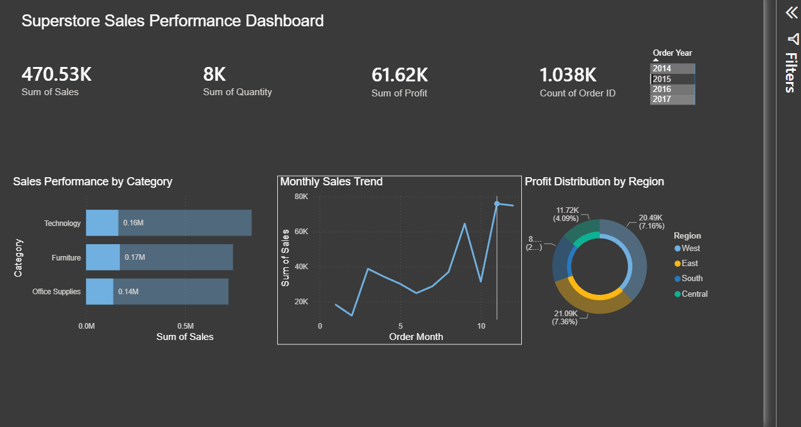
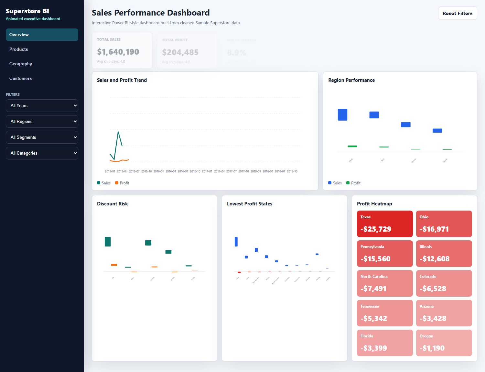

<b>العربية</b> · <a href="#english-version">English</a>

# تحليل مبيعات Superstore

تحليل شامل لبيانات مبيعات Superstore (9,994 طلبًا) — من تنظيف البيانات الخام في Python، مرورًا بأسئلة العمل في SQL، وصولًا إلى لوحة Power BI تفاعلية. الهدف كان تحويل ملف معاملات فوضوي إلى قراءة واضحة لما يقود الربح، وأين يتسرّب.

## ما تكشفه الأرقام

قطاع التقنية يحمل النشاط — يتصدّر الإيراد (836 ألف$) والربح (145 ألف$). الأثاث هو المشكلة الصامتة: يبيع بقدر المستلزمات المكتبية تقريبًا لكنه لا يربح سوى 18 ألف$، بهامش 2.5%. والسبب الخصومات — الطلبات المخفّضة فوق 30% تخسر باستمرار، بمتوسط **-156$ للطلب** في شريحة 30–50%، وهو ما يفسّر ضعف هامش الأثاث.

إقليميًا، الغرب هو الأصحّ بهامش 14.9%، بينما الوسط يبيع أكثر من الجنوب ويربح أقل (7.9%) — مشكلة تسعير أو خصم، لا مشكلة طلب. المبيعات تبلغ ذروتها في نوفمبر وديسمبر وتهبط في فبراير، والشحن العادي يستغرق خمسة أيام مقابل 2.2 للشحن السريع.

## كيف بُني

نظّفت الملف الخام (9,994 صف) في Python (pandas): حلّلت حقول التاريخ، واشتققت أعمدة الشهر ومدة الشحن، وفحصت الفراغات والتكرارات. ثم أجبت الأسئلة نفسها مرتين — مرة في Python ومرة في SQL (SQLite) — للتحقق المتقاطع من الأرقام ولإظهار الطريقين للوصول لنفس النتيجة.

**الأدوات:** Python (pandas, NumPy) للتنظيف والاستكشاف · SQL (SQLite) لأسئلة العمل · Power BI للوحة · Excel كمصدر وكعرض جدولي.

## الداشبوردات

النتائج نفسها معروضة بثلاث صيغ، ولكل واحدة دورها:

- **Power BI** (`.pbix`) — **اللوحة التحليلية الأساسية.** مبنية على نموذج نجمي صغير (عميل، تاريخ، منتج، جغرافيا، طريقة شحن)، ببطاقات KPI وسلايسر سنة ورسوم للفئات والاتجاه الشهري والربح الإقليمي. هذه هي **الأداة العاملة** — تفلترها وتقرأ الأرقام منها. مجلد `powerbi/` فيه نموذج بياناتها.

- **Excel** (`dashboards/`) — **بديل تفاعلي** مبني بـPivotTables وSlicers، لمن يفضّل استكشاف الأرقام في جدول.

- **ويب / HTML** (`dashboards/superstore_animated_dashboard.html`) — **عرض بصري فقط.** صفحة واحدة متحركة تحكي قصة النتائج؛ الغرض منها أن يُنظر إليها لا أن يُحلَّل بها — اعتبرها البوستر لا الأداة. التحليل والأرقام تعيش في ملف Power BI، وهذه مجرد طريقة أجمل لعرضها.

## البنية

- `01_data_cleaning.ipynb` — التنظيف والتحليل الاستكشافي في Python
- `superstore_queries.sql` — أسئلة العمل بـSQL (SQLite)
- `Superstore Sales Performance Dashboard.pbix` — لوحة Power BI
- `powerbi/` — نموذج البيانات النجمي للوحة
- `dashboards/` — نسختا Excel والويب (البصرية)
- `data/processed/` — الجداول الملخّصة خلف كل عرض
- `docs/` — ملاحظات نموذج البيانات والتصميم

---

<a href="#تحليل-مبيعات-superstore">العربية</a> · <b>English</b>

# Superstore Sales Analysis

An end-to-end analysis of the Superstore retail dataset (9,994 orders) — from cleaning the raw export in Python, through SQL business questions, to an interactive Power BI dashboard. The aim was to turn a messy transactional file into a clear read on what drives profit, and where it leaks.

## What the data shows

Technology carries the business — it leads on both revenue ($836K) and profit ($145K). Furniture is the quiet problem: it sells almost as much as Office Supplies but returns only $18K in profit, a 2.5% margin. The culprit is discounting — orders discounted above 30% consistently lose money, averaging **-$156 profit per order** in the 30–50% band, which lines up with Furniture's weak returns.

Regionally, the West is healthiest at a 14.9% margin, while Central sells more than the South yet earns a thinner 7.9% — a pricing or discount issue rather than a demand one. Sales peak in November and December and bottom out in February, and Standard Class shipping averages five days against 2.2 for First Class.

## How it was built

I cleaned the raw 9,994-row export in Python (pandas): parsed the date fields, engineered order-month and shipping-duration columns, and checked for nulls and duplicates. I then answered the core business questions twice — once in Python, once in SQL (SQLite) — partly to cross-check the numbers, partly to show both routes to the same insight.

**Tools:** Python (pandas, NumPy) for cleaning and EDA · SQL (SQLite) for the business questions · Power BI for the dashboard · Excel as the source and for a spreadsheet view.

## The dashboards

The same findings are presented in three formats, each with a different job:

- **Power BI** (`.pbix`) — **the main, analytical dashboard.** Built on a small star schema (customer, date, product, geography, and ship-mode), with KPI cards, a year slicer, and charts for category performance, the monthly trend, and regional profit. This is the working tool: you filter it and read the numbers off it. The `powerbi/` folder holds its data model.

- **Excel** (`dashboards/`) — **an interactive alternative** built with PivotTables and slicers, for anyone who'd rather explore the same numbers in a spreadsheet.

- **Web / HTML** (`dashboards/superstore_animated_dashboard.html`) — **a visual presentation only.** A single scrollable, animated page that tells the story of the findings; it's meant to be looked at, not filtered or analyzed — the poster, not the tool. The analysis and the numbers live in the Power BI file; this is just a nicer way to show them off.

## Structure

- `01_data_cleaning.ipynb` — cleaning and exploratory analysis in Python
- `superstore_queries.sql` — the SQL business questions (SQLite)
- `Superstore Sales Performance Dashboard.pbix` — the Power BI dashboard
- `powerbi/` — the dashboard's star-schema data model
- `dashboards/` — the Excel and web (visual) versions
- `data/processed/` — the summarized tables behind each view
- `docs/` — data model and dashboard notes
